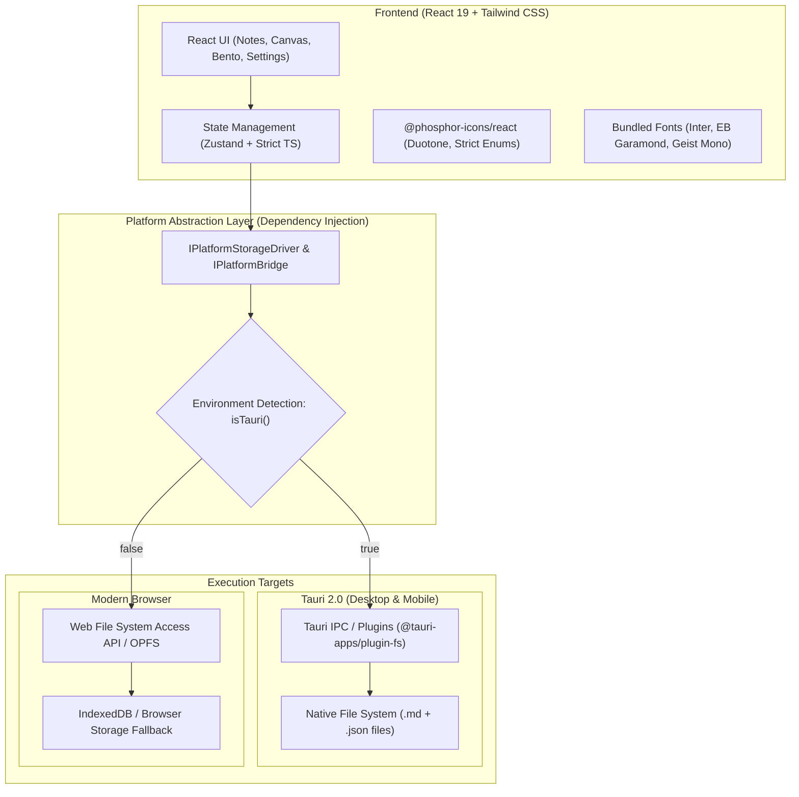

# 📐 Tesseract: Architecture & Repo Setup Guide
**Target System:** Local-First, Cross-Platform Desktop/Mobile/Web Application  
**Core Technologies:** React 19 + TypeScript (Strict) + Vite + TailwindCSS + Tauri 2.0 + Phosphor Icons  
**Author / Team:** Nitrox / Tesseract  

---

## info
## Agent Codebase Rules & Boundaries

When developing or refactoring Tesseract code, all AI assistants and coding agents must respect these guidelines:

1. **No External CDN Injections**: Never introduce `<script src="https://...">` or `<link href="https://...">` tags. All libraries must be npm-managed and offline-capable.
2. **Platform Parity Rule**: Never call `@tauri-apps/api/*` directly from React components. All native calls must flow through the abstraction adapters (`src/lib/storage/`, `src/lib/platform/`).
3. **Strict Typing Discipline**:
   - No `any` types permitted.
   - Use discriminant unions for task/object types (`type: 'note' | 'task' | 'canvas'`).
   - All file-system parsing (e.g., YAML frontmatter) must be validated with runtime guards or Zod schemas.
4. **File-First Immutability**: Tesseract never saves user content into opaque binary blobs. Content lives in human-readable `.md` files and `.json` layout manifests.

---

## 3. Frontmatter & Card Schema Contract

Agents parsing or generating Tesseract documents must output this exact YAML frontmatter structure:

```markdown
---
id: "tess_<nanoid>"
title: "Document Title"
type: "task-doc" | "note" | "canvas-card"
tags: ["tag1", "tag2"]
created: 2026-10-16T10:00:00Z
updated: 2026-10-16T11:00:00Z
time_tracked: 0
status: "todo" | "in-progress" | "done"
---

# Document Title
Markdown body content here...


## 1. Executive Architecture Overview

Tesseract is architected as a **Dual-Target, Local-First application**. The primary requirement is that the user's React frontend runs seamlessly inside:
1. **Desktop & Mobile native windows** (powered by Tauri 2.0 Webview + Rust core).
2. **Web browsers** (as a zero-install Progressive Web App / static web app).

To make the app **100% offline-ready** from the first render, all network-blocking external CDNs (Google Fonts, jsDelivr, etc.) are replaced with zero-latency, local-bundled assets.



---

## 2. Eliminating Network Dependencies (Offline-First Ready)

### 2.1 The Problem in Current `index.html` & `styles.css`
In the initial static version:
- `styles.css` imported Google Fonts over HTTP (`@import url('https://fonts.googleapis.com/...');`).
- `index.html` fetched Phosphor icons via jsDelivr CDN (`<link rel="stylesheet" href="https://cdn.jsdelivr.net/...duotone/style.css" />`).
- `index.html` loaded Typed.js from CDN (`<script src="https://cdn.jsdelivr.net/npm/typed.js..."></script>`).

> [!CAUTION]
> **Why this breaks offline apps:** When a native Tauri window launches without an active internet connection, the WebView stalls DOM rendering waiting for DNS resolution and TLS handshakes to `fonts.googleapis.com` and CDNs. This leads to a blank screen (FOIT - Flash of Invisible Text) or network timeout errors.

### 2.2 The Solution
1. **Self-Hosted / Bundled Fonts via `@fontsource`:**
   Bundle font binaries directly into the Vite build pipeline:
   - `@fontsource/inter` (UI & Sans-serif)
   - `@fontsource/eb-garamond` (Serif Display & Headings)
   - `@fontsource/geist-mono` (Code & Markdown syntax)
   - `@fontsource/instrument-sans` (Secondary Sans)
   - `@fontsource/instrument-serif` (Accent Serif)
2. **Modular SVG Icons via `@phosphor-icons/react`:**
   Instead of a global CSS icon webfont, React renders inline SVG icons directly. This ensures:
   - 0ms network latency.
   - Automatic tree-shaking (only the icons you actually render get bundled).
   - Full TypeScript autocomplete for icon weights (`"bold" | "duotone" | "fill" | "light" | "regular" | "thin"`).
3. **Local NPM Dependencies:**
   Install `typed.js` via `npm install typed.js` and wrap it in a custom React hook (`useTyped`).

---

## 3. Directory Structure for Clean Web + Tauri Coexistence

```text
tesseract/
├── src-tauri/                     # Rust backend configuration & capabilities
│   ├── Cargo.toml                 # Rust dependencies
│   ├── tauri.conf.json            # Tauri 2.0 configuration
│   ├── capabilities/              # Tauri 2.0 security permissions (fs, dialog)
│   │   └── default.json
│   └── src/
│       └── lib.rs / main.rs       # Rust entrypoint & custom IPC commands
├── src/                           # Frontend React application
│   ├── assets/                    # Static images, logos, textures (.png, .svg)
│   ├── components/                # UI components
│   │   ├── bento/                 # Feature bento cards
│   │   ├── canvas/                # Nitrox Easel canvas components
│   │   ├── common/                # Buttons, modals, dropdowns
│   │   └── layout/                # Window frame, titlebar, navigation
│   ├── core/                      # Domain logic & platform abstraction
│   │   ├── platform/              # Web vs. Tauri bridge adapters
│   │   │   ├── types.ts           # Storage & platform interfaces
│   │   │   ├── tauri-driver.ts    # Tauri plugin-fs / IPC implementation
│   │   │   ├── web-driver.ts      # Web File System Access / OPFS implementation
│   │   │   └── index.ts           # Auto-detecting driver factory
│   │   ├── parser/                # Markdown + YAML frontmatter parser
│   │   └── types/                 # Domain models (Note, Task, Card, Canvas)
│   ├── hooks/                     # Custom React hooks (useStorage, useTyped, etc.)
│   ├── store/                     # Reactive state management (Zustand)
│   │   ├── canvas-store.ts        # Spatial grid coordinates & card layout
│   │   └── notes-store.ts         # Active document & file tree state
│   ├── styles/                    # Global styling & Tailwind directives
│   │   ├── fonts.css              # Local @fontsource imports
│   │   └── globals.css            # Tailwind directives & CSS variable tokens
│   ├── App.tsx                    # Root React component
│   └── main.tsx                   # React DOM render entrypoint
├── index.html                     # Clean, offline-ready HTML entry point
├── package.json                   # Scripts & dependencies
├── postcss.config.js              # PostCSS config for Tailwind
├── tailwind.config.ts             # Strict TypeScript Tailwind configuration
├── tsconfig.json                  # Root TypeScript project references
├── tsconfig.app.json              # Strict TS config for React frontend
├── tsconfig.node.json             # TS config for Vite / Tailwind config files
└── vite.config.ts                 # Dual-target Vite configuration
```

---

## 4. Strict TypeScript Setup

To level up your TypeScript expertise, the project is configured with maximum type rigor (`strict: true`, `noUncheckedIndexedAccess: true`).

### 4.1 `tsconfig.app.json`
```json
{
  "compilerOptions": {
    "target": "ES2022",
    "useDefineForClassFields": true,
    "lib": ["ES2022", "DOM", "DOM.Iterable"],
    "module": "ESNext",
    "skipLibCheck": true,

    /* Bundler mode */
    "moduleResolution": "bundler",
    "allowImportingTsExtensions": false,
    "resolveJsonModule": true,
    "isolatedModules": true,
    "moduleDetection": "force",
    "noEmit": true,
    "jsx": "react-jsx",

    /* Strict Type-Checking Options */
    "strict": true,
    "noUncheckedIndexedAccess": true,
    "exactOptionalPropertyTypes": true,
    "noImplicitReturns": true,
    "noFallthroughCasesInSwitch": true,
    "noImplicitOverride": true,

    /* Path Aliases */
    "baseUrl": ".",
    "paths": {
      "@/*": ["src/*"]
    }
  },
  "include": ["src"]
}
```

> [!NOTE]
> **Why `noUncheckedIndexedAccess: true` is crucial:**  
> When accessing an array or dictionary like `const card = layout[0]`, default TypeScript assumes `card` is defined. With `noUncheckedIndexedAccess`, TS types it as `Card | undefined`, forcing you to write defensive code (`if (!card) return;`), which prevents unexpected runtime crashes.

---

## 5. The Dual-Target Platform Abstraction Layer

Never call Tauri's `@tauri-apps/plugin-fs` directly from inside your React buttons or components. Instead, design a **Driver / Strategy pattern**.

### 5.1 Platform Interface (`src/core/platform/types.ts`)
```typescript
export interface FileItem {
  id: string;
  name: string;
  path: string;
  isDirectory: boolean;
  size?: number;
}

export interface IPlatformStorageDriver {
  isSupported(): boolean;
  pickWorkspaceDirectory(): Promise<string | null>;
  readFile(path: string): Promise<string>;
  writeFile(path: string, content: string): Promise<void>;
  listFiles(directoryPath: string): Promise<FileItem[]>;
  deleteFile(path: string): Promise<void>;
}

export interface PlatformEnvironment {
  isTauri: boolean;
  platform: 'desktop' | 'mobile' | 'web';
  os?: 'macos' | 'windows' | 'linux' | 'ios' | 'android';
}
```

### 5.2 Environment Detection (`src/core/platform/detect.ts`)
```typescript
import type { PlatformEnvironment } from './types';

export function getPlatformEnvironment(): PlatformEnvironment {
  const isTauri = typeof window !== 'undefined' && '__TAURI_INTERNALS__' in window;

  if (isTauri) {
    // Tauri desktop/mobile detection
    return {
      isTauri: true,
      platform: 'desktop', // Can refine with @tauri-apps/plugin-os
    };
  }

  return {
    isTauri: false,
    platform: 'web',
  };
}
```

### 5.3 Tauri Driver (`src/core/platform/tauri-driver.ts`)
```typescript
import { readTextFile, writeTextFile, readDir } from '@tauri-apps/plugin-fs';
import { open } from '@tauri-apps/plugin-dialog';
import type { IPlatformStorageDriver, FileItem } from './types';

export class TauriStorageDriver implements IPlatformStorageDriver {
  isSupported(): boolean {
    return typeof window !== 'undefined' && '__TAURI_INTERNALS__' in window;
  }

  async pickWorkspaceDirectory(): Promise<string | null> {
    const selected = await open({
      directory: true,
      multiple: false,
      title: 'Select Tesseract Workspace Folder',
    });
    return typeof selected === 'string' ? selected : null;
  }

  async readFile(path: string): Promise<string> {
    return await readTextFile(path);
  }

  async writeFile(path: string, content: string): Promise<void> {
    await writeTextFile(path, content);
  }

  async listFiles(directoryPath: string): Promise<FileItem[]> {
    const entries = await readDir(directoryPath);
    return entries.map((entry) => ({
      id: `${directoryPath}/${entry.name}`,
      name: entry.name,
      path: `${directoryPath}/${entry.name}`,
      isDirectory: entry.isDirectory,
    }));
  }

  async deleteFile(path: string): Promise<void> {
    // Implemented via remove from @tauri-apps/plugin-fs
  }
}
```

### 5.4 Web Fallback Driver (`src/core/platform/web-driver.ts`)
```typescript
import type { IPlatformStorageDriver, FileItem } from './types';

export class WebStorageDriver implements IPlatformStorageDriver {
  private directoryHandle: FileSystemDirectoryHandle | null = null;

  isSupported(): boolean {
    return typeof window !== 'undefined' && 'showDirectoryPicker' in window;
  }

  async pickWorkspaceDirectory(): Promise<string | null> {
    if (!this.isSupported()) {
      throw new Error('File System Access API is not supported in this browser.');
    }
    this.directoryHandle = await window.showDirectoryPicker();
    return this.directoryHandle.name;
  }

  async readFile(fileName: string): Promise<string> {
    if (!this.directoryHandle) throw new Error('No workspace directory opened.');
    const fileHandle = await this.directoryHandle.getFileHandle(fileName);
    const file = await fileHandle.getFile();
    return await file.text();
  }

  async writeFile(fileName: string, content: string): Promise<void> {
    if (!this.directoryHandle) throw new Error('No workspace directory opened.');
    const fileHandle = await this.directoryHandle.getFileHandle(fileName, { create: true });
    const writable = await fileHandle.createWritable();
    await writable.write(content);
    await writable.close();
  }

  async listFiles(): Promise<FileItem[]> {
    if (!this.directoryHandle) return [];
    const items: FileItem[] = [];
    for await (const [name, handle] of (this.directoryHandle as any).entries()) {
      items.push({
        id: name,
        name,
        path: name,
        isDirectory: handle.kind === 'directory',
      });
    }
    return items;
  }

  async deleteFile(fileName: string): Promise<void> {
    if (!this.directoryHandle) throw new Error('No workspace directory opened.');
    await this.directoryHandle.removeEntry(fileName);
  }
}
```

---

## 6. Tailwind CSS & Design System Integration

Map the design tokens from your existing `styles.css` directly into `tailwind.config.ts`.

### `tailwind.config.ts`
```typescript
import type { Config } from 'tailwindcss';

export default {
  content: ['./index.html', './src/**/*.{js,ts,jsx,tsx}'],
  theme: {
    extend: {
      colors: {
        background: '#0f0f0f',
        primary: {
          DEFAULT: '#A161EA',
          shadow: 'rgba(161, 97, 234, 0.24)',
        },
        secondary: '#C897FF',
        nitrox: '#0B73EE',
        window: {
          bg: '#29292d',
          close: '#ff5f57',
          minimize: '#febc2e',
          maximize: '#28c840',
        },
      },
      fontFamily: {
        sans: ['Inter', 'system-ui', 'sans-serif'],
        serif: ['EB Garamond', 'Georgia', 'serif'],
        mono: ['Geist Mono', 'monospace'],
        display: ['Instrument Serif', 'serif'],
        heading: ['Instrument Sans', 'sans-serif'],
      },
    },
  },
  plugins: [],
} satisfies Config;
```

---

## 7. Vite Configuration for Web & Tauri 2.0

### `vite.config.ts`
```typescript
import { defineConfig } from 'vite';
import react from '@vitejs/plugin-react';
import path from 'path';

// @ts-expect-error process is available in node build environment
const host = process.env.TAURI_DEV_HOST;

export default defineConfig({
  plugins: [react()],
  resolve: {
    alias: {
      '@': path.resolve(__dirname, './src'),
    },
  },
  // Prevent Vite from obscuring Rust compile errors
  clearScreen: false,
  server: {
    // Tauri expects a fixed port, fail if that port is not available
    strictPort: true,
    port: 1420,
    host: host || false,
    hmr: host
      ? {
          protocol: 'ws',
          host,
          port: 1421,
        }
      : undefined,
    watch: {
      // Tell vite to ignore watching src-tauri
      ignored: ['**/src-tauri/**'],
    },
  },
  envPrefix: ['VITE_', 'TAURI_ENV_*'],
  build: {
    // Tauri uses Chromium on Windows and WebKit on macOS/Linux
    target: process.env.TAURI_ENV_PLATFORM == 'windows' ? 'chrome105' : 'safari13',
    // Don't minify for debug builds
    minify: !process.env.TAURI_ENV_DEBUG ? 'esbuild' : false,
    // Produce sourcemaps for debug builds
    sourcemap: !!process.env.TAURI_ENV_DEBUG,
  },
});
```

---

## 8. Type-Safe Frontmatter & Note Domain Models

Using strict TypeScript with discriminated unions for Markdown card types:

```typescript
import { z } from 'zod';

// Runtime validation schema for YAML frontmatter
export const NoteFrontmatterSchema = z.object({
  id: z.string(),
  title: z.string().default('Untitled'),
  type: z.enum(['task-doc', 'note', 'flashcard', 'whiteboard']),
  tags: z.array(z.string()).default([]),
  created: z.string(),
  updated: z.string().optional(),
  time_tracked: z.number().default(0),
  status: z.enum(['todo', 'in-progress', 'done', 'archived']).default('todo'),
});

export type NoteFrontmatter = z.infer<typeof NoteFrontmatterSchema>;

// Strict spatial grid model for the Easel Canvas
export interface CanvasCardCoordinate {
  card_id: string;
  x: number;
  y: number;
  w: number;
  h: number;
  zIndex: number;
}

export interface CanvasManifest {
  canvas_id: string;
  title: string;
  updated_at: string;
  layout: CanvasCardCoordinate[];
}
```

---

## 9. Step-by-Step Implementation Roadmap

| Phase | Objective | Key Deliverables |
| :--- | :--- | :--- |
| **Phase 1: Scaffolding** | Initialize modern build tools & package manifest | `package.json`, `vite.config.ts`, `tsconfig.json`, Tailwind config |
| **Phase 2: Offline Assets** | Cut network tether and embed local assets | Install `@fontsource/*` fonts, `@phosphor-icons/react`, clean `index.html` |
| **Phase 3: Abstraction Bridge** | Create platform-agnostic storage layer | `IPlatformStorageDriver`, `TauriStorageDriver`, `WebStorageDriver` |
| **Phase 4: UI & State** | Implement React 19 UI with strict Zustand state | Window frame, Bento cards, Typed hero banner, File navigation |
| **Phase 5: Tauri Core** | Initialize Rust native wrapper | `cargo tauri init`, configure `tauri.conf.json`, test desktop window |
| **Phase 6: File-First Engine** | Frontmatter parser & local markdown persistence | Read/write local `.md` documents with YAML headers |
